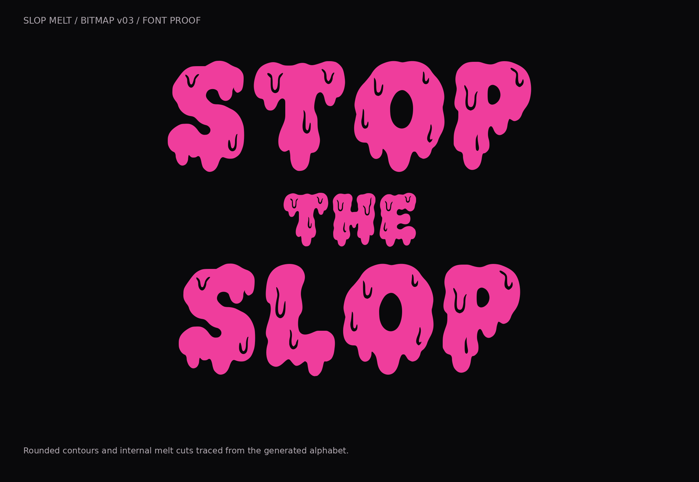
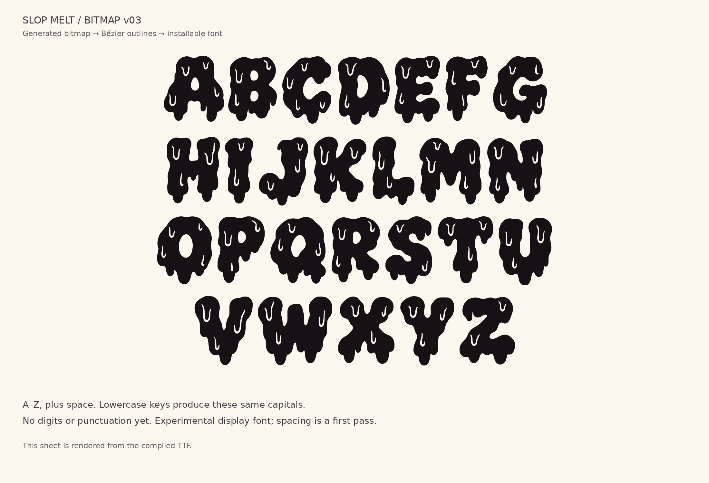
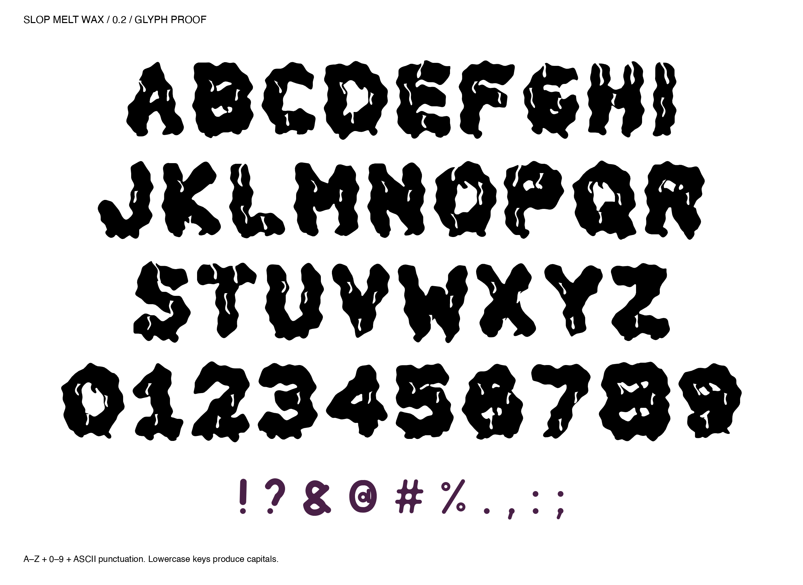
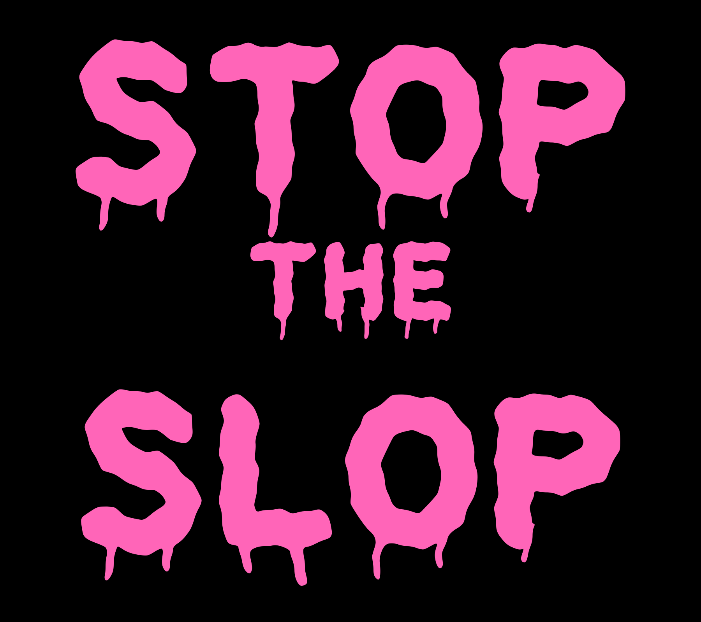
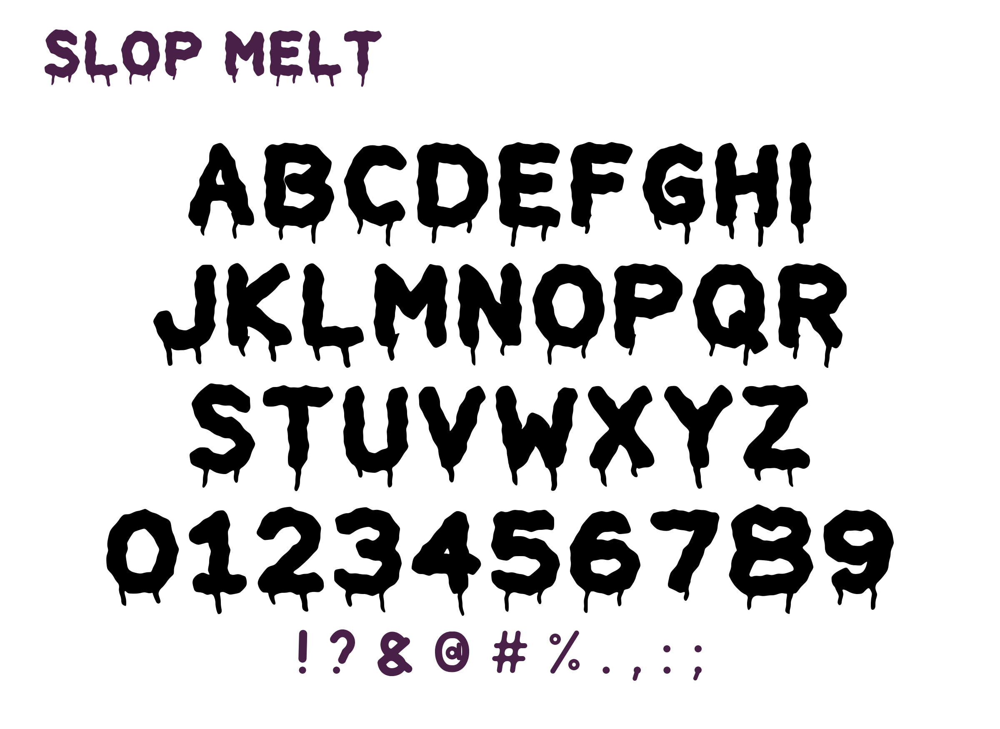

# Slop Melt

Three experiments in chunky, melting display type, made for **STOP THE SLOP**.

[](versions/v03-bitmap/dist/)

## Versions

Each version has its own family name. You can install them together.

| Version | Direction | Downloads | Coverage | Status |
| --- | --- | --- | --- | --- |
| 0.3 · Slop Melt Bitmap v03 | Generated alphabet traced into outlines | [TTF](versions/v03-bitmap/dist/Slop-Melt-Bitmap-v03-Regular.ttf?raw=true), [OTF](versions/v03-bitmap/dist/Slop-Melt-Bitmap-v03-Regular.otf?raw=true), [WOFF](versions/v03-bitmap/dist/Slop-Melt-Bitmap-v03-Regular.woff?raw=true) | A–Z with lowercase aliases, space and nonbreaking space | Installable bitmap-derived prototype; first-pass spacing, no pair kerning |
| 0.2 · Slop Melt Wax | Folds through faces and counters | [TTF](versions/v02-wax/assets/SlopMeltWax-Regular.ttf?raw=true), [UFO](versions/v02-wax/source/SlopMeltWax-Regular.ufo) | Same coverage as 0.1 | Installable wax study; 14 kerning pairs |
| 0.1 · Slop Melt | Procedural outlines and hanging drips | [TTF](assets/SlopMelt-Regular.ttf?raw=true), [UFO](source/SlopMelt-Regular.ufo) | A–Z, digits, printable ASCII, punctuation aliases; lowercase keys produce capitals | Original display prototype; 14 kerning pairs |

All three are single-style outline fonts. Accents, non-Latin scripts, and
separately drawn lowercase aren't included. Version 0.3 has no digits or
punctuation. Thin drip tips and internal cuts need inspection at the final print
size. No physical print or broad publishing-app compatibility testing is claimed.

## Where it started

I wanted a melting font for a STOP THE SLOP shirt. The starting point was the
pink GITHUB sticker in [this GitHub sticker pack](https://thegithubshop.com/collections/stickers/products/1547508-00-logo-stickers-pack-of-12).
We couldn't identify the original typeface, so I asked Codex to make a new one.
The original sticker font and designer remain unidentified. The sticker's
photograph and wordmark aren't included in this repository.

## 0.3 · Slop Melt Bitmap v03

[Download TTF, OTF, or WOFF](versions/v03-bitmap/dist/)

[](versions/v03-bitmap/dist/)

The third version starts with a newly generated alphabet bitmap rather than
procedural letter skeletons. The generation record identifies the built-in image
tool and the earlier pink STOP THE SLOP experiment as the style reference; it
doesn't record a specific model version. The [prompt](versions/v03-bitmap/generation-prompt.txt)
and [original 1484 × 1060 alphabet bitmap](versions/v03-bitmap/Slop-Melt-Bitmap-v03-A-Z.png)
are included.

The builder thresholds the bitmap at 128, isolates its 26 connected letters with
SciPy, and traces the contours with Potrace 1.16. Each row is scaled into common
font coordinates. The TTF uses quadratic curves converted with FontTools Cu2Qu;
the CFF OTF retains cubic curves, and WOFF packages the TrueType font. The inner
creases and counters are real holes in the outlines.

Each format contains 28 glyphs and 54 Unicode mappings: 26 capitals, lowercase
aliases, space and nonbreaking space. Spacing is a first pass with no pair
kerning. The Q's small tail can make it look close to O. This is an experimental
display font, with no digits or punctuation yet.

See the [version notes and rebuild instructions](versions/v03-bitmap/README.md)
for its source bitmap, isolated glyph bitmaps, traced SVGs, and build records.
The original font files and proof images are preserved unchanged. The script's
shared-library lookup and proof-caption font handling have been made portable.

## 0.2 · Slop Melt Wax

[Download TTF](versions/v02-wax/assets/SlopMeltWax-Regular.ttf?raw=true)

[](versions/v02-wax/assets/SlopMeltWax-Regular.ttf)

For the second direction, I wanted the melting to happen through the letter
faces and inner negative spaces. This version thickens the bodies, adds curved
channels and wax tongues inside counters, and replaces the long filaments with
shorter, blunt lobes. G, I, T, O, P, S, H, E, and L have individually placed folds.
The remaining letters and digits use the related construction; punctuation
retains the 0.1 shapes.

This is an actual installable TTF with editable UFO source, 71 glyphs, 103 Unicode
mappings, and 14 pair adjustments. It uses Shapely, FontTools, and ufoLib2, with
positive and negative wax shapes added to the original procedural approach.
No image-generation model or borrowed font outlines were used.

See the [version notes and rebuild instructions](versions/v02-wax/README.md),
[colorways](docs/v02-colorways.png), and [black SVG](versions/v02-wax/assets/Stop-The-Slop-Wax-v02-black.svg).

## 0.1 · Slop Melt

[Download TTF](assets/SlopMelt-Regular.ttf?raw=true)

[](assets/SlopMelt-Regular.ttf)

[](assets/SlopMelt-Regular.ttf)

The first version has uneven edges, open faces, and thin drips hanging from the
bottom. It contains 71 glyphs and 103 mapped codepoints, covering all 95 printable
ASCII characters plus a few aliases. Curly quotes share the straight-quote
designs; en and em dashes share the hyphen. There are 14 kerning pairs.

Codex wrote [the Python generator](source/build_font.py). It defines original
letter skeletons with line segments and sampled cubic Bézier curves. Shapely
thickens and merges those paths, adds tapered drip polygons, and applies small,
repeatable sine-wave displacements. The A's counter is opened explicitly.
FontTools turns the oriented contours into softened quadratic outlines and adds
advance widths, side bearings, cmap, metrics, naming tables, and GPOS kerning.
ufoLib2 saves the editable UFO. No raster tracing or image-generation model was
used to draw this version. Paper was used to arrange and review SVG lettering.

The published 0.1 font, editable sources, generator, and original specimens remain
byte-for-byte unchanged. Its earlier publication updated only the embedded license
description to WTFPL; the letterforms match the initial 0.1 build.

A [black SVG graphic](assets/stop-the-slop-black.svg) is available for recoloring.

## Rebuild and validate

Use Python 3.12 or newer to build all versions (the pinned NumPy and SciPy
versions for 0.3 require it):

```sh
python3 -m venv .venv
. .venv/bin/activate
pip install -r requirements.txt
```

Each builder writes into its own version's directories:

```sh
# Original 0.1 (rebuilding rewrites its generated outputs)
python source/build_font.py
python source/render_specimens.py

# Wax 0.2
python versions/v02-wax/source/build_font.py

# Bitmap 0.3: also needs a separately installed Potrace shared library
pip install -r versions/v03-bitmap/requirements.txt
python versions/v03-bitmap/build_font.py
```

Version 0.3 discovers Potrace with `ctypes.util.find_library`; set
`POTRACE_LIBRARY` to an absolute library path if needed. `LABEL_FONT` optionally
selects an installed font for proof captions, otherwise Pillow's default is used.
No Potrace binary or third-party font file is bundled. Rebuilding does not call
an image model; the source bitmap is already included. See the per-version notes
for details.

To check the supplied artifacts without rebuilding or overwriting them:

```sh
python scripts/validate_versions.py
```

The validator checks all five font files, character coverage, lowercase aliases,
metrics, table round trips, rasterization, imported-font hashes, unchanged 0.1
files, and local Markdown image links. The [validation report](docs/versions-validation.json)
records the results. Fontconfig's broader English-language coverage check reports
missing characters; these are deliberately limited display prototypes.

The [scratch rebuild report](docs/rebuild-validation.json) records successful
0.2 and 0.3 rebuilds. The 0.3 macOS rebuild has tiny rounding differences in D
and H (up to 2 font units); bit-identical cross-platform rebuilds aren't claimed.
All supplied font files are preserved exactly.

## License

The original Slop Melt font work, code, and specimens are offered under
[WTFPL version 2](LICENSE). Copyright 2026 Zeke Sikelianos.

The standard license document credits its author, Sam Hocevar. Build dependencies
keep their own licenses; see [THIRD_PARTY.md](THIRD_PARTY.md). The unchanged 0.2
font still mentions its initial MIT grant, whose notice is retained alongside it;
the original work is also offered under WTFPL. The imported 0.3 fonts have no
embedded license-description field, so this repository supplies the grant.

No third-party package binaries, fonts, sticker photograph, or GitHub wordmark
are bundled. This project grants no rights to GitHub's artwork or trademarks.
