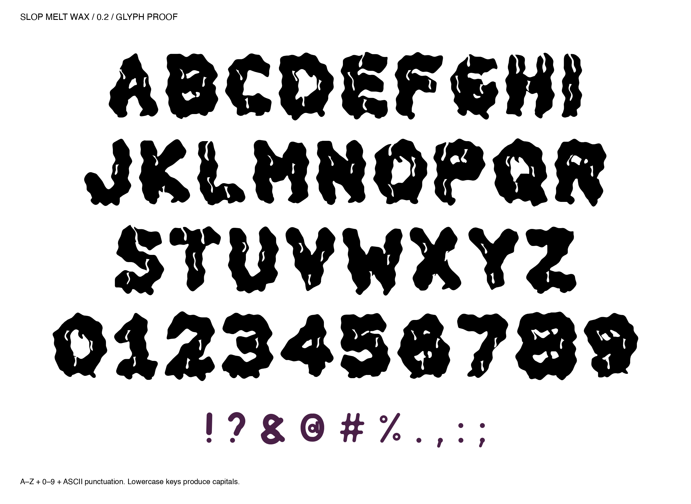

# Slop Melt Wax 0.2

The second direction moves the melting into the glyph faces and counters.
It has thicker bodies, curved negative folds, wax tongues inside the counters,
and shorter, blunt lobes at the bottom. G, I, T, O, P, S, H, E, and L have
individually placed folds; the remaining alphabet and digits use the related
construction. Punctuation retains the original 0.1 shapes.



## Status and coverage

This is an installable, experimental TrueType display font, not just a lettering
image. The family is **Slop Melt Wax**, distinct from the original Slop Melt.
There are 71 glyphs and 103 Unicode mappings: A–Z, digits, all printable ASCII,
nonbreaking space, curly quote aliases, dash aliases, and ellipsis. Lowercase
keys produce capitals. It has 14 pair adjustments and no accents or non-Latin.

- [Installable TTF](assets/SlopMeltWax-Regular.ttf?raw=true)
- [Editable UFO](source/SlopMeltWax-Regular.ufo)
- [Generator](source/build_font.py)
- [Black vector artwork](assets/Stop-The-Slop-Wax-v02-black.svg)
- [Three colorways](../../docs/v02-colorways.png)

## Origin and construction

Codex built this as a separate variation after the 0.1 study. The same original
Python skeletons are thickened with Shapely, then modified with positive wax
tongues and negative fold polygons at multiple heights. Deterministic warps
soften and displace the contours. FontTools converts them to quadratic glyphs,
adds metrics, cmap and GPOS kerning, and builds the TTF. ufoLib2 saves the UFO.
No raster image-generation model or third-party font outlines were used.

The historical pink GitHub sticker inspired the exploration; its font remains
unidentified. Its photograph and wordmark are not included.

## Rebuild

From the repository root, install `requirements.txt` into a Python 3.11+ virtual
environment, then run:

```sh
python versions/v02-wax/source/build_font.py
python scripts/validate_versions.py
```

The builder writes only this version's `assets/` and `source/` directories.
It does not rebuild or overwrite 0.1. The README specimen is a preserved export
of the original font proof; the validator also rasterizes all covered characters.

The supplied 0.2 font and UFO are preserved unchanged. Their initial embedded
license description refers to MIT; the original MIT notice is retained in
`LICENSE.txt`. The original work is also available under the repository's
[WTFPL v2 grant](../../LICENSE). Dependencies retain their own licenses.

The narrow cuts need inspection at the final print size. No physical print or
commercial publishing-application test is claimed.
